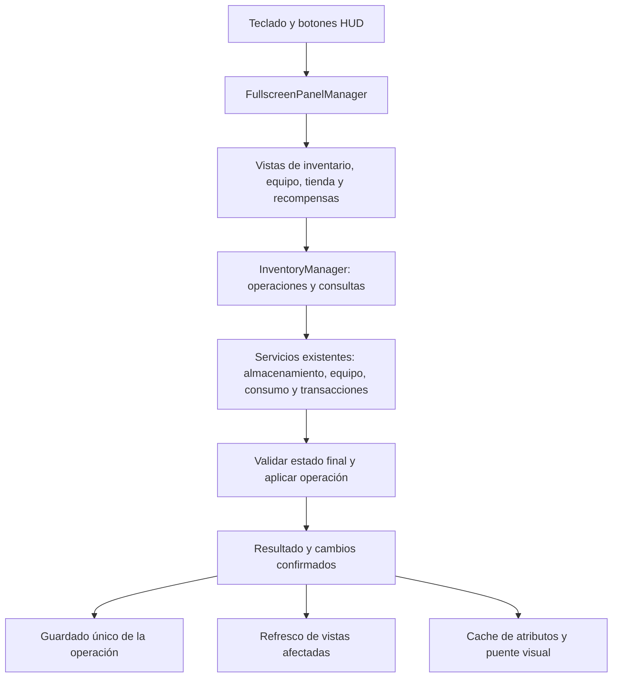

# Inventario: control, interfaz y simplificación

> **Registro histórico (2026-10-08).** Describe el estado y las decisiones de esa fecha; no se reescribe. Para el estado vigente, ver [Arquitectura actual](1_Arquitectura_Actual.md) y, para movimiento, [TroopMovementPipeline](../TroopMovementPipeline.md). Los nombres de sistemas o valores citados aquí pueden haber cambiado.

Revisión inicial: 2026-10-08, sobre `53fa5804`. Implementación y validación: 2026-10-09.

Los apartados de diagnóstico describen el estado previo a la refactorización. El estado entregado y la cobertura están en «Cambios aplicados y validación», al final del documento.

## Alcance y conclusión

Revisión estática del catálogo, instancias, almacenamiento, equipamiento, consumibles, efectos, tienda, recompensas, persistencia, controles, celdas, selector, tooltips y consumidores de los eventos. Se contrastaron referencias de scripts en prefabs/escenas y el grafo actualizado desde ese commit. No se ejecutó una sesión de juego ni se modificó código de producción como parte de esta revisión.

La base es aprovechable: definición de ítem separada de instancia, servicios especializados, una fachada pública y celdas compartidas. La complejidad principal está en la coordinación: varios héroes activos estáticos, operaciones repartidas entre UI y servicios, guardados intermedios y eventos redundantes. Hay fallos funcionales que conviene corregir antes de eliminar o fusionar clases.

La simplificación propuesta conserva el formato de las partidas, los assets, los prefabs y las funcionalidades actuales. Primero concentra cada operación y su publicación de cambios; después reduce duplicación y estados de UI.

## Funcionamiento actual

### Datos y catálogo

- `ItemDataSO` define ID, tipo/categoría, rareza, icono, parte visual, generador de stats, efectos y configuración de precio. También contiene `stackable`, `consumeOnUse`, `requiresConfirmation` y texto de uso.
- `EnhancedItemDatabase` contiene las definiciones. `ItemService` las carga y cachea; `InventoryUtils.GetItemData` es otro punto de acceso a ese servicio.
- `ItemInstanceService.CreateItem` crea `InventoryItem`. Los objetos con generador reciben GUID y stats aleatorios, siempre con cantidad 1; los demás no reciben GUID y conservan la cantidad solicitada. Calcula el precio de instancia al crearlos.
- `InventoryItem` persiste ID, tipo, cantidad, precio, slot y stats. Los stats se serializan como array y se leen mediante un diccionario en memoria.
- `HeroData.inventory` contiene la mochila. `HeroData.equipment` contiene los objetos equipados completos en seis campos. Equipar retira el objeto de la mochila y fija su `slotIndex` a -1.
- `SaveSystem` guarda todo `PlayerData`, incluido el héroe, mediante un proveedor intercambiable y escritura JSON atómica. La atomicidad del archivo no hace atómica una operación de compra o equipamiento de varios pasos.

### Control y apertura

`HeroInputSystem.manageUIDisplays` procesa I (inventario), P (héroe), B (barracas), Escape y Alt en fase Feudo. Los botones HUD también pasan por `FullscreenPanelManager`. Este manager coordina exclusividad entre paneles y el modo UI: cursor libre, cámara detenida y `DialogueUIState.IsDialogueOpen`, que bloquea las entradas de juego.

La UI de inventario está referenciada en `FeudoScene` y `UIInventory.prefab`. La preparación de batalla reutiliza panel de equipo y selector. `InventoryDragHandler` no está serializado como componente en los assets encontrados: la celda lo añade dinámicamente.

### Mochila y acciones

`InventoryPanelController` crea una grilla de 9 × 8, igual a los 72 slots del límite por defecto del almacenamiento, pero ambos valores se configuran por separado. En filtro All conserva `slotIndex`; en Equipment/Stackable compacta la vista. Ordenar y arrastrar se permiten sólo en All, lo que evita confundir índice visual filtrado con posición persistida.

La celda presenta icono, rareza y cantidad. `BaseItemCellInteraction` emite click/hover y cambios de contenido. El click derecho del inventario equipa armas/armaduras o usa consumibles. El arrastre dibuja un icono temporal, busca destino con raycast y llama a `InventoryPanelController.SwapItems`.

### Equipo y preparación

`HeroEquipmentPanel` coordina cinco armaduras y arma. Cada `HeroEquipmentSlotController` consulta el equipo, representa placeholder y valida el tipo/categoría visualmente. Click izquierdo abre `ItemSelectorController`, paginado en diez celdas; seleccionar llama a equipar. Click derecho en detalle de héroe desequipa si hay espacio.

`EquipmentManagerService` retira el objeto, asigna el slot equipado y devuelve el objeto anterior a la posición liberada. Tiene reglas arma/armadura y devolución de piezas incompatibles. Los controladores de detalle y preparación repiten parte de la selección y refresco.

Los eventos de equipo alimentan `DataCacheService`, que recalcula atributos con debounce; `HeroDetailStatsPanel` escucha el cache. `HeroVisualEquipmentSystem` escucha equipar/desequipar y cambia la apariencia del héroe local. El preview de detalle observa ese modelo mediante una cámara y RenderTexture.

### Consumibles, tienda y recompensas

`ConsumableManagerService` aplica `ItemEffectSystem`, reduce cantidad y notifica. Los efectos son ScriptableObjects: moneda, entrega de equipo y elección de arma con diálogo. El sistema valida y ejecuta efectos por prioridad, pero no revierte efectos previos si uno posterior falla.

La tienda crea una instancia por producto, con stats y precio mostrados. La UI compra transfiriendo esa instancia exacta y vende desde el inventario auxiliar mediante click derecho. `StoreTransactionService` existe, pero no tiene consumidores C# encontrados: compra y venta reales están implementadas en `UIStoreController`.

Hay funciones presentadas que todavía son placeholders: los botones de reparación sólo escriben TODO en el log y el tooltip muestra durabilidad fija `100/100`. Preservar la funcionalidad implementada no implica que estos sistemas ya existan.

### Tooltips

`TooltipManager` conecta hover/cambios de celda a tooltip primario y comparación secundaria. `InventoryTooltipController` coordina ciclo de vida, contenido, stats, posición y validación. El posicionamiento contempla bordes y pares de tooltips. Hay validación periódica cada 0,2 segundos y también callbacks de cambio de celda. Las filas de stats se destruyen y recrean al poblar contenido.

## Problemas funcionales encontrados

Los siguientes son resultados de inspección de las ramas y llamadas; su frecuencia visible en cada escena requiere pruebas de juego.

| Prioridad | Evidencia | Consecuencia | Corrección propuesta |
|---|---|---|---|
| Alta | `EquipmentManagerService.cs:147` llama a `executeCompatibilityValidations` sin utilizar su bool. | Se sigue equipando aunque no haya espacio o falle devolver una pieza incompatible. | Devolver el resultado de validación y calcular la operación completa antes de mutar. |
| Alta | `EquipmentManagerService.cs:560` consulta repetidamente `HasSpace` sin reservar slots; `UnequipIncompatiblePieces` modifica y publica pieza por pieza. | Con un hueco y varias piezas incompatibles se aprueba una capacidad inexistente; puede quedar una modificación parcial. | Calcular el balance exacto considerando el slot liberado por el objeto entrante y el reemplazo; aplicar todo junto. |
| Alta | `PlayerSessionService.cs:20`, `InventoryManager.cs:34`, `HeroDetailUIController.cs:142` y `HeroDetailEquipmentSlot.cs:140`. | La sesión cambia equipo/eventos, pero no siempre mochila/consumibles/fachada. Un panel sólo mira IsInitialized, no si coincide el héroe. Hay rutas de mezcla entre héroes. | Vincular todos los servicios al seleccionar héroe y desvincularlos al limpiar sesión; retirar inicialización de las vistas. |
| Alta | `BaseItemCellController.cs:70` sale de `SetItem(null, null)` antes de limpiar `_interaction`. El selector usa esa llamada para huecos y cambios de página. | Una celda visualmente vacía puede conservar el objeto anterior para click o hover. | Una sola operación de asignación limpia presentación, interacción, selección y drag cuando recibe null. |
| Alta | `UIStoreController.cs:178` calcula venta de una unidad y `:184` retira el objeto completo. | Vender un stack de N elimina N pero paga sólo una unidad. También ignora el precio de la instancia. | Centralizar venta con cantidad explícita y `ItemPricingService.CalculateItemSellPrice(definición, instancia)`. |
| Alta | `RewardDialogUIController.cs:33` añade listener al abrir y `Close` no lo retira. | Reabrir acumula callbacks; aceptar puede ejecutar otra vez después de limpiar dialogData. | Vincular una vez o reemplazar el listener; aceptar exactamente una vez. |
| Media | `ConsumableManagerService.cs:157–194` divide cantidad y añade con `AddExistingItem`, que fusiona por itemId. | SplitStack devuelve éxito sin producir dos stacks: se vuelve a sumar al original. | Agregar al slot libre concreto sin autoapilar. |
| Media | `InventoryManager.cs:171–199` devuelve mover/intercambiar/retirar cantidad sin emitir cambio ni guardar. | Estas APIs no tienen el contrato de persistencia de agregar/quitar objeto. | Completar todas las mutaciones en el mismo punto de notificación. |
| Media | `InventoryPanelController.cs:475` escribe `slotIndex` y llama directamente a SaveSystem. | El arrastre usa una ruta diferente de la API y no avisa a otros observadores. | Delegar movimiento/intercambio al dominio y refrescar por su evento. |
| Media | `HeroEquipmentSlotInteraction.cs:74` añade callback; RemoveEvents heredado sólo retira callbacks base. | Reconfigurar slots acumula acciones del selector. BaseItemCellInteraction.SetEvents tampoco reemplaza por sí mismo el vínculo anterior. | Distinguir asignación de handler de suscripción múltiple y limpiar ambos eventos en la misma pareja bind/unbind. |
| Media | `EquipmentGrantEffect.cs:52,62,70` crea un objeto, crea otro al agregar y publica el primero otra vez. | Se genera equipo desechado y se notifica una instancia distinta de la recibida, además de eventos/guardados duplicados. | Crear una vez y entregar esa instancia mediante la fachada. |
| Media | `ItemDataSO` define consumeOnUse/requiresConfirmation; no se encontraron lecturas operativas de estas propiedades. | El consumo siempre reduce cantidad y no respeta esas opciones del asset. La confirmación de compatibilidad también queda en TODO. | Conectar las opciones al contrato de operación y al diálogo existente. |
| Media | `UseConsumableQuantity` sigue tras fallos y descuenta toda la cantidad; `ItemEffectSystem` no revierte efectos ya aplicados. | Pueden cobrarse consumibles fallidos o repetirse recompensas tras un fallo parcial. | Definir éxito por unidad/operación y consumir sólo al completar; reservar resultados pendientes para efectos con selección. |
| Media | `ChooseWeaponRewardEffect.Execute` devuelve éxito al abrir; `SimpleRewardDialogDataSO.DeliverRewards` ignora el resultado de agregar. | Se consume antes de confirmar entrega y el diálogo puede cerrar aunque el inventario no admita la recompensa. | Separar pendiente/completado/cancelado, validar espacio al aceptar y confirmar consumo con entrega. |
| Media | `TooltipDataValidator.cs:54–55` compara un objeto con su misma referencia mutable y no actúa cuando ya no se encuentra. | El polling puede no detectar cambios de cantidad/stats ni desaparición; además sólo consulta mochila aunque se muestran equipo y tienda. | Invalidar por evento/contexto y conservar una versión o snapshot del contenido mostrado. |
| Media | `TooltipManager.cs:263,282,293` usa ShowTooltipInstant en el hover normal. | hoverDelay está configurado pero se omite en esa ruta. | Un único estado de hover con delay, cancelación y contexto; refrescos de un tooltip ya abierto pueden ser instantáneos. |
| Media | `OnSetItem` llama a dual sólo por enableComparisonTooltips; ShowDualTooltips accede al secundario antes de comprobar null. | Falta validar si el ítem admite comparación y si existen ambas vistas. El modo global cambia entre paneles. | Contexto por celda/panel y ruta simple/dual segura. |
| Media | `TooltipFormattingUtils.GetActionText` decide la acción por definición y tipo primario/secundario, no por modo de interacción. | La misma celda de inventario auxiliar vende con click derecho, mientras el texto de equipo primario sigue indicando Equipar. | Derivar instrucciones y acciones disponibles del mismo contexto que ejecuta el click. |
| Baja | `InventoryEventService.ValidateEquippedItem` exige encontrar lo equipado en la mochila. | Advierte sobre un estado normal: equipar lo retira de allí. La advertencia no altera el bool de validación general. | Validar exclusión entre ubicaciones y unicidad, no presencia duplicada. |

Otros riesgos de APIs actualmente sin consumidores encontrados: SwapEquipment valida sólo ItemType y no categoría, no publica cambios; CombineStacks no comprueba pertenencia al inventario ni que origen y destino sean distintos; compras de varias unidades de equipo en StoreTransactionService cobran N pero CreateItem produce una instancia. Corregirlos con pruebas antes de exponerlos en nuevas pantallas.

## Duplicación y complejidad que se puede retirar

1. **UI y transacciones:** extender el servicio existente para aceptar la instancia ofertada, conservar sus stats/precio y gestionar cantidad/stock. La UI no debe debitar, retirar objetos ni guardar. No sustituir la compra actual por PurchaseItem(itemId) sin adaptar el servicio: volvería a generar el equipo que el jugador ya inspeccionó.
2. **Eventos:** agregar/quitar objeto dispara evento específico y general; InventoryPanelController escucha ambos y dibuja dos veces. Moneda también usa el evento general; reabrir el inventario auxiliar repite inicialización y dibujo. Publicar un resultado final con áreas afectadas: mochila, equipo, moneda. Los listeners específicos de cache/apariencia se conservan durante la migración.
3. **InventoryUIUtils:** no tiene llamadas externas C# encontradas y duplica la grilla/monedas/botones. Su grilla ni siquiera incorpora la compactación por filtros de la implementación activa. Mantener una única implementación; comprobar referencias de assets antes de eliminar su .meta.
4. **Compatibilidad:** EquipmentCompatibilityInfo y CompatibilityConflictType aparecen globales y anidados en el servicio. Mantener una sola forma de datos; eliminar wrappers privados de compatibilidad sin uso.
5. **Reflexión:** la celda usa Type.GetType y nombres de método para el drag. Ambos pertenecen a Game.ECS sin separación de assemblies que lo exija. Usar referencia InventoryDragHandler y llamadas tipadas. También Escape puede cerrar el IFullscreenPanel activo directamente en vez de MakeGenericMethod.
6. **Celdas:** conservar la base compartida y pequeños adaptadores de inventario/equipo. Darles un contrato SetItem/Clear coherente y handlers reemplazables. Evitar nuevas jerarquías genéricas o fusionar todos los comportamientos en una megaclase.
7. **Tooltips:** conservar comparación, formato y posicionamiento. Eliminar la validación por mochila en favor del contexto y eventos; reutilizar filas de stats; concentrar propiedad de la vista simple/dual en TooltipManager. Sólo consolidar clases pequeñas después de dejar claras sus responsabilidades.
8. **Catálogo:** ItemService construye índices por categoría/armadura/rareza que no utiliza en sus consultas; GetFilteredItems filtra otra vez todos los valores. Usar los índices si aportan o quitarlos. El problema prioritario sigue siendo consistencia, no LINQ para 72 slots.
9. **Identidad y definición:** IsEquipment/IsStackable se decide por GUID en InventoryItem, por generador/efectos en ItemDataSO y por tipo/stackable en utilidades y UI. Centralizar reglas de definición y validar instancias al cargar, sin reinterpretar silenciosamente partidas anteriores.
10. **Sólo lectura:** IHeroInventory devuelve List y Equipment mutables. Las facetas reducen dependencia nominal, pero no impiden escritura. Exponer consultas de sólo lectura al UI y reservar mutaciones para las operaciones.
11. **Stats persistidos:** GeneratedStats devuelve el diccionario mutable; modificarlo directamente no actualiza serializedStats. No se encontró una escritura externa actual por índice, así que es un riesgo de API, no pérdida de stats observada. Usar lectura de sólo lectura más SetStat y setters de lote sincronizados.
12. **Capacidad/configuración:** definir capacidad una vez y derivar la grilla de ella; parametrizar tamaño de página, apariencia de drag y opciones de tooltip donde corresponda. Un límite por defecto y un 9 × 8 independiente permiten desajustes al tunear.

## Flujo recomendado

Es un flujo objetivo. Hoy la tienda y el arrastre evitan parte de esa ruta y algunas operaciones publican estados intermedios.

La sesión debe establecer un único contexto de héroe compartido. Las vistas reciben consultas y envían intenciones; no inicializan servicios ni modifican HeroData. Para la primera fase se puede conservar InventoryManager como fachada estática compatible y propagar el contexto a los servicios desde un solo punto. Convertir todos los servicios a instancias no es requisito para arreglar los fallos; es una evolución posterior si se necesitan inventarios simultáneos.

Cada operación valida antes de cambiar el estado y comunica su resultado con un motivo: sin espacio, objeto ajeno, incompatibilidad, fondos insuficientes o recompensa pendiente. TransactionResult ya existe para tienda y se puede extender o reutilizar antes de introducir otro contenedor de errores. Un bool por sí solo obliga a la UI a repetir validaciones para explicar el fallo.

El inventario persistente puede seguir en C# gestionado. El puente hacia apariencia y atributos debe respetar la separación ECS/Sync/GameObject: HeroVisualEquipmentSystem hoy localiza todos los GameObjects por ID dentro de un SystemBase. Aprovechar la vinculación de EntityVisualSync para localizar el visual asociado y aplicar cambios en la capa de presentación. VisualPrefabRegistry se ocupa de prefabs, no es un registro existente de instancias.

## Reutilización comprobada

| Elemento existente | Decisión |
|---|---|
| InventoryManager | Extender como fachada única; conservar llamadas públicas mientras se migra. |
| InventoryStorageService | Reutilizar para operaciones primitivas; añadir modos explícitos de apilar/colocar y una validación de integridad. |
| EquipmentManagerService | Reutilizar reglas, sustitución y consultas; rehacer preparación/aplicación del cambio completo. |
| ConsumableManagerService + ItemEffectSystem | Reutilizar; definir éxito parcial y efectos pendientes correctamente. |
| StoreTransactionService + TransactionResult | Extender y conectar a UI; conservar instancia ofertada y corregir atomicidad. |
| InventoryEventService | Extender como publicación del resultado confirmado; separar del diagnóstico de integridad. |
| ItemService + EnhancedItemDatabase | Conservar catálogo/cache; reducir índices y acceso redundante. |
| BaseItemCellController + BaseItemCellInteraction | Conservar base; corregir limpieza y propiedad de callbacks. |
| TooltipManager y utilidades de comparación/formato/posición | Conservar comportamiento; quitar consultas periódicas sin contexto. |
| SaveSystem/ISaveProvider | Conservar formato y proveedor; aprovechar proveedor en memoria para pruebas. |
| IHeroInventory/IHeroInventoryMutator | Extender separación lectura/escritura en lugar de crear otra familia paralela de interfaces. |
| EntityVisualSync/VisualSyncUtility | Reutilizar el puente visual; no crear otro sistema de búsqueda global. |

También se buscaron servicios Core, utilidades Shared, componentes/sistemas Hero/Squads y Events. No existe allí un comando transaccional de inventario que ya resuelva el conjunto. No se propone crear un segundo inventario ECS.

## Orden de implementación

1. **Fijar comportamiento con pruebas.** Cubrir stacks, slots, cambio de héroe, precio/instancia de tienda, fallos de capacidad y callbacks vacíos/repetidos. Establecer invariantes de identidad, cantidad y ubicación.
2. **Corregir integridad y ciclo de sesión.** Compatibilidad ignorada, capacidad exacta, SplitStack, venta de stacks, limpieza de celdas y callbacks. Inicializar/desvincular desde la sesión.
3. **Unificar mutaciones y finalización.** Mover arrastre y transacciones de UI a servicios. Una operación completada, un resultado, una publicación, un guardado. Mantener eventos compatibles para los consumidores actuales.
4. **Simplificar vistas.** Dependencias tipadas, handlers idempotentes, refresco por área afectada y componentes reutilizados. Retirar InventoryUIUtils y tipos duplicados cuando la búsqueda de referencias confirme que es seguro.
5. **Cerrar consumibles/recompensas y tooltips.** Respetar flags; entrega pendiente/confirmada; hover con delay/cancelación; comparación con contexto y filas reutilizables.
6. **Limpieza final de APIs/configuración y puente visual.** Capacidad única, consultas de sólo lectura, clasificación coherente y retiro de índices innecesarios. Validar assets reales y mantener compatibilidad de datos.

No conviene renombrar campos serializados, cambiar todos los MonoBehaviours o convertir el inventario entero a ECS en la primera entrega. Antes de cualquier migración de datos, incorporar fixtures de partidas existentes. Si se cambia un campo serializado, usar FormerlySerializedAs o migración explícita y verificar referencias de prefabs.

## Pruebas necesarias para conservar funcionalidad

No se encontraron tests específicos de inventario, tienda, consumibles, equipo o tooltips en `Assets/Tests`. Las suites actuales de batalla y arquitectura no sustituyen esta cobertura.

**EditMode con proveedor en memoria:** agregar objeto nuevo; apilar con mochila llena; colocar en slot concreto; mover/intercambiar; retirar cantidad desde el stack seleccionado; dividir y combinar; rechazar autoapilado y objetos ajenos; equipar/reemplazar/desequipar; compatibilidad con cero/uno/varios slots libres; fallo sin cambios parciales; compra con stats/GUID/precio idénticos al producto inspeccionado; venta completa/parcial con precio por cantidad; preservación de monedas ante fallo; una notificación y un guardado por operación; cambio de héroe y cierre de sesión; JSON de instancias, stats y equipo con save/load.

**PlayMode con prefabs reales:** abrir/cerrar desde teclado/HUD/Escape; cursor/cámara y exclusividad; filtros sin modificar slots reales; arrastre sólo en All; click derecho equipa/usa/vende según contexto; selector paginado sin clicks de objetos anteriores; diez reaperturas sin callbacks duplicados; inventario auxiliar vuelve a modo normal; comparación de stats/rareza y bordes de pantalla; cancelación y confirmación de recompensas con mochila llena; cambios visibles de equipo y atributos en detalle/preparación/modelo.

**Escenas:** FeudoScene para inventario completo, tienda, recompensa y detalle; BattlePrepScene para selección de equipo previa a batalla. BattleTestScene sirve como regresión posterior de stats/apariencia en combate, pero no contiene por sí sola toda la UI de inventario inspeccionada.

**Criterios de aceptación:** ninguna pérdida/duplicación de objetos o moneda; ninguna operación fallida deja cambios parciales; mismo equipo mostrado y adquirido; partidas previas cargan igual; todas las interacciones siguen disponibles; una entrega/acción por click; sin errores al repetir aperturas; refresco y guardado ocurren al confirmar el estado final.

## Cambios aplicados y validación (2026-10-09)

Se conserva la fachada y los servicios existentes, los GUID de scripts/prefabs anteriores y el formato de las partidas. Los cambios se han aplicado en el orden propuesto; no se ha convertido el inventario a ECS.

| Área | Resultado entregado |
|---|---|
| Sesión | `PlayerSessionService` vincula almacenamiento, equipo, consumo, moneda, tienda y eventos al mismo héroe. Seleccionar otro héroe refresca las vistas sin guardar una mutación; cerrar sesión desvincula servicios y cancela diálogos. |
| Operaciones compuestas | `InventoryEventService.RunTransaction` restaura mochila, equipo, cantidades, slots, precios, stats, monedas y estado aleatorio si la operación falla. Los eventos específicos se publican sobre el estado final; el guardado y el evento general se emiten una vez. |
| Equipo | Capacidad calculada considerando la entrada y todas las piezas incompatibles. La entrada libera su hueco antes de devolver otras piezas. Se valida propiedad por referencia y categoría del slot; se comparte el tipo de compatibilidad existente. |
| Stacks y slots | Dividir coloca una nueva pila en otro slot, sin apilarla inmediatamente. Combinar rechaza la misma instancia y cantidades que desbordan. Retirar/vender cantidades actúa sobre la pila elegida; se reparan slots inválidos o repetidos de pilas y equipo al vincular. |
| Tienda | Compra y venta usan `StoreTransactionService`; la compra conserva la instancia, stats y precio mostrados. La venta paga cada unidad. Las compras apilables pueden usar una pila existente con mochila llena. Una oferta vendida rechaza clicks posteriores incluso antes de destruir su GameObject. |
| Consumibles/recompensas | Se respetan `consumeOnUse` y `requiresConfirmation`. Una elección pendiente no consume el objeto; cancelar permite reabrir. Aceptar entrega y consume en una transacción. El último consumible libera su slot para la recompensa. Las plantillas SO se clonan, no se modifican. |
| Interfaz | Arrastre y tienda envían operaciones al dominio. Las celdas vacías limpian datos e interacción; callbacks idempotentes. La grilla deriva su capacidad del servicio. Selección, compra, venta y equipo tienen contextos explícitos. Escape usa la interfaz del panel. El modo UI se limpia al destruir el gestor de la escena. |
| Diálogo compartido | Confirmación y recompensa usan el mismo controlador, con aceptar/cancelar. El diálogo de Feudo se ha reutilizado como prefab en BattlePrepScene, mediante APIs del editor Unity. |
| Tooltips | Hover con retraso cancelable, comparación según contexto, contenido actualizado para instancias mutables y filas reutilizables. Las filas ocultas también actualizan sus textos. Se retira la durabilidad ficticia y la búsqueda periódica del objeto en la mochila para productos de tienda. |
| Apariencia | `HeroVisualEquipmentInitializer` se vincula mediante `EntityVisualSync` al héroe local y aplica el equipo final. Se retira `HeroVisualEquipmentSystem`, su suscripción ECS y su búsqueda global de GameObjects. |
| Limpieza | Retirados `InventoryUIUtils`, índices de catálogo sin consumidores, helpers sin llamadas y reflexión del drag. `GeneratedStats` expone lectura y conserva setters que sincronizan el array persistido. Nuevos ajustes visuales quedan serializados. |

### Evidencia de ejecución

Unity Editor conectado: **6000.5.8f1**. Se comprobó compilación sin errores. La inspección nativa del prefab compartido confirmó todas sus referencias requeridas y botones aceptar/cancelar sin solapamiento. Suites finales: **98/98 EditMode** y **27/27 PlayMode**, sin tests omitidos ni inconclusos.

Se añadieron **18 regresiones EditMode** de inventario y **5 PlayMode**: cuatro con UI de Feudo/preparación, una con el visual real de BattleTestScene. Las regresiones de locomoción, combate y navegación existentes también pasan. Los proveedores de guardado de las pruebas son de memoria; no escriben la partida del jugador. Resultados completos locales: `Logs/inventory-final-editmode.json` y `Logs/inventory-final-playmode.json`.

La cobertura de UI verifica: limpiar celdas y hover pendiente, refrescar stats sin recrear filas, configurar callbacks repetidamente sin duplicarlos, comprar la instancia ofrecida, vender mediante inventario auxiliar, impedir segunda compra de una oferta vendida, cancelar/reabrir/aceptar una recompensa con mochila llena, confirmar/cancelar equipo en preparación y cambiar de héroe con inventario abierto.

`graphify update .` ha actualizado el grafo local. Se actualizó también `SystemResponsibilities.md` para reflejar el puente de apariencia y el flujo de inventario.

### Límites y evolución posterior

- Se conserva la clasificación GUID/generador de las partidas existentes y la API mutable de `HeroData` por compatibilidad. La UI migrada usa operaciones de los servicios y copias de listas; convertir todas las interfaces de persistencia a colecciones inmutables o soportar varios inventarios simultáneos requiere otra migración explícita.
- La transacción garantiza atomicidad del estado en memoria. El contrato actual `SaveSystem`/`ISaveProvider` no propaga un resultado de fallo de escritura al llamador; este cambio no incorpora rollback de errores de disco.
- Los efectos interactivos actuales admiten una selección y una unidad por operación. El diálogo entrega todo o permanece abierto para reintento; efectos futuros que modifiquen progresión ajena al inventario deberán ampliar el snapshot o preparar sus cambios antes de aplicarlos.
- Las pruebas de UI cargan escenas y prefabs reales, pero aíslan `HeroSpawnSystem` en Feudo: el arranque actual puede registrar un squad ID vacío fuera de batalla. El spawn y la locomoción se comprueban por separado en BattleTestScene. Esto no constituye una validación completa del gameplay de Feudo ni una inspección visual manual de todas las resoluciones.
- Reparación y durabilidad siguen sin lógica de gameplay implementada. No se añadieron sistemas ficticios para sus placeholders.
